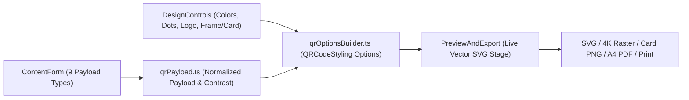

<div align="center">

# QRForge Studio

### Custom Vector SVG &amp; 4K Printable QR Code Generator

Create high-resolution, scan-verified QR codes for any link, Wi-Fi network, digital contact card, WhatsApp chat, or printable table sign — **100% client-side** in your browser.

[](https://qrforge-studio-bt.web.app)
[](https://react.dev/)
[](https://www.typescriptlang.org/)
[](https://tailwindcss.com/)
[](https://vite.dev/)

**[Open Live Studio](https://qrforge-studio-bt.web.app)** •
**[Features](#-features)** •
**[Customization Studio](#-interactive-customization-guide)** •
**[Architecture](#-architecture)** •
**[Quick Start](#-quick-start)**

</div>

---

> [!TIP]
> **Zero tracking, zero server uploads:** Every QR matrix, uploaded center logo, PNG/SVG export, and A4 PDF is generated locally inside your browser. Saved designs stay strictly in your browser's `localStorage`.

---

## ✨ Features

| Category | What's Included |
| :--- | :--- |
| **9 Dynamic Content Types** | Website Link/URL (with optional UTM builder), Wi-Fi, vCard 3.0, WhatsApp, Plain Text, Email, Phone, SMS, and GPS Coordinates |
| **8 Curated Style Presets** | *Electric Indigo*, *Classic Ink*, *Ocean Pulse*, *Sunset Ember*, *Emerald Forest*, *Champagne Luxe*, *Rose Quartz*, and *Cyber Dark* |
| **Deep QR Geometry** | Square & Circular QR shapes, 6 data dot styles, 3 corner frame styles, 2 pupil styles, quiet-zone margin, and background corner rounding |
| **Color & Gradient Engine** | Solid, Linear (0°–360°), and Radial gradients, independent Corner Eye colors, transparent background support, and live contrast guard |
| **Center Logo Studio** | 16 crisp built-in vector icons, custom 1–5 character monogram badges, or local image uploads (`PNG`, `SVG`, `JPG`, `WebP`) |
| **Scan Frames & Printable Cards** | 6 scan frames (*Bottom Pill*, *Scan Banner*, *Tag Card*, *Dark Frame*, *Badge Border*) + 4 full printable card templates |
| **Multi-Format 300 DPI Exports** | Infinite Vector `SVG`, `512px`–`4096px (4K)` `PNG`/`JPEG`/`WebP`, Framed/Card high-DPI `PNG`, print-ready `A4 PDF`, clipboard copy, and browser print |

---

## 🎛 Interactive Customization Guide

Click any section below to explore every option available in the studio:

<details>
<summary><b>1. Supported QR Content Types &amp; Quick Starters</b></summary>

- **Link / URL (Default):** Auto-normalizes missing `https://`, includes quick domain prefixes (`https://`, `https://linktr.ee/`, `https://instagram.com/`), a one-click **Open Link** tester, and an optional **UTM Campaign Builder** (`utm_source`, `utm_medium`, `utm_campaign`).
- **Wi-Fi (`WIFI:T:...`):** Supports `WPA/WPA2/WPA3`, `WEP`, and `nopass`, hidden SSID toggle, password visibility toggle, and automatic special-character escaping.
- **vCard 3.0 Contact:** Encodes first/last name, organization, job title, mobile phone, email, website, and work address.
- **WhatsApp (`wa.me`):** International number formatting + pre-filled encoded message.
- **Email / Phone / SMS / Location / Text:** Generates standard `mailto:`, `tel:`, `SMSTO:`, `geo:lat,lng`, and UTF-8 plain text payloads with live byte-size inspection.
- **Quick Starters:** One-click starter profiles for *Website / Portfolio*, *Guest Wi-Fi Sign*, *Digital Menu*, and *Luxury Event / Wedding*.

</details>

<details>
<summary><b>2. Pattern, Colors &amp; Scanability Guard</b></summary>

- **Data Modules (`dotsOptions.type`):** `square`, `rounded`, `dots`, `extra-rounded`, `classy`, `classy-rounded` + pixel-crisp module snapping (`roundSize`).
- **Finder Eyes:** Independent **Corner Outer Frame** (`square`, `extra-rounded`, `dot`) and **Corner Inner Pupil** (`square`, `dot`) with optional custom colors separate from the data dots.
- **Fills &amp; Transparency:** Solid, Linear Gradient (customizable 0°–360° angle), and Radial Gradient for both dots and QR background, plus **Transparent Background** mode with an alpha checkerboard stage preview.
- **Scanability Guard:** Calculates WCAG relative-luminance contrast between foreground and background colors in real time and warns on low-contrast or inverted palettes.
- **Technical Specs:** Configurable Error Correction Level (`L` 7%, `M` 15%, `Q` 25%, `H` 30%), Quiet Zone margin (`0–40px`), background corner radius (`0–50%`), and matrix density (`Auto` or fixed versions `2`–`20`).

</details>

<details>
<summary><b>3. Center Logo &amp; Monogram Studio</b></summary>

- **16 Vector Icons:** Link, Web, Wi-Fi, Chat, Contact, Mail, Phone, Shop, Menu, Map, Brand, Heart, Event, Audio, Photo, and Verify — with customizable icon and backdrop colors.
- **Custom Text Badge:** 1–5 character initials/labels (e.g., `QR`, `VIP`, `MENU`) rendered as crisp inline SVG badges.
- **Custom Image Upload:** Client-side `FileReader` import for `PNG`, `JPEG`, `SVG`, or `WebP`.
- **Precision Controls:** Adjustable logo scale (`15%–45%`), logo padding (`0–20px`), badge shape (`Circle`, `Rounded`, `Icon Only`), and module clearing behind the logo (`hideBackgroundDots`).

</details>

<details>
<summary><b>4. Scan Frames &amp; Printable Card / Sign Studio</b></summary>

- **QR &amp; Frame Mode:** Wrap the live QR in `Clean QR`, `Bottom Pill`, `Scan Banner`, `Tag Card`, `Dark Frame`, or `Badge Border` with editable call-to-action text, corner radius, and custom colors.
- **Printable Card Mode:** Switch to full print-ready signs using **Modern Minimal**, **Arch Luxury**, **Midnight Slate**, or **Table Standee** layouts with selectable proportions (`5:7` Table Sign, `4:5` Social Flyer, `1:1` Square Card), 4 typography pairings, custom eyebrow/heading/subtitle/footer text, optional decorative inner arch/frame border, and link summary toggle.

</details>

<details>
<summary><b>5. Export Formats &amp; Local Design History</b></summary>

| Export Option | Output Spec | Best For |
| :--- | :--- | :--- |
| **Vector SVG** | Scalable vector paths (`qr-code-styling`) | Print shops, Figma/Illustrator, signage &amp; billboards |
| **High-Res QR** | `512px`, `1024px`, `2048px`, `4096px (4K)` in `PNG`/`JPEG`/`WebP` | Websites, slide decks, flyers, merchandise |
| **Framed / Card PNG** | `3.5x` pixel-ratio capture via `html-to-image` | Social sharing, table tents, digital menus |
| **Print-Ready PDF** | Centered A4 portrait/landscape PDF via `jsPDF` | Immediate home or office printing |
| **Clipboard &amp; Print** | `1024px` PNG Clipboard API + `@media print` view | Instant paste into docs/chats or direct printing |

- **Studio Productivity:** Use **Surprise Style** for instant curated combinations, **Save Design** to bookmark up to 10 configurations in `localStorage`, and **Reset** to restore defaults.

</details>

---

## 🏗 Architecture



```text
qr_generator/
├── index.html                  # App shell, metadata & Google Fonts
├── firebase.json               # Firebase Hosting config (serves dist/ with SPA rewrites)
├── .firebaserc                 # Firebase project alias (qrforge-studio-bt)
├── tailwind.config.js          # Custom typography & brand/gold tokens
├── src/
│   ├── App.tsx                 # Main studio state, localStorage history, Surprise/Reset
│   ├── types.ts                # Shared TypeScript interfaces for content, QR, frame & card
│   ├── data/presets.ts         # 8 theme presets, 16 vector icons, card templates & starters
│   ├── utils/
│   │   ├── qrPayload.ts        # Payload builders (URL/UTM, Wi-Fi, vCard, WA, etc.) & contrast
│   │   └── qrOptionsBuilder.ts # Maps StudioState into qr-code-styling Options
│   └── components/
│       ├── ContentForm.tsx     # Dynamic form tabs for all 9 content modes
│       ├── DesignControls.tsx  # 4-tab visual customization studio
│       └── PreviewAndExport.tsx# Live stage, Frame/Card wrapper & multi-format exporters
└── tests/
    └── qrLogic.test.ts         # Unit tests for payload encoding, contrast & QR options
```

---

## 🚀 Quick Start

### Prerequisites
- **Node.js** `>= 20` and **npm**

### Local Development

```bash
# 1. Clone the repository
git clone https://github.com/BasharTaha06/qr_generator.git
cd qr_generator

# 2. Install dependencies
npm install

# 3. Start the Vite dev server
npm run dev
```

### Available Scripts

| Command | Description |
| :--- | :--- |
| `npm run dev` | Start local Vite development server with HMR |
| `npm test` | Run unit tests in `tests/qrLogic.test.ts` via `jiti` |
| `npm run typecheck` | Run TypeScript compiler check (`tsc --noEmit`) |
| `npm run build` | Typecheck and bundle production assets into `dist/` |
| `npm run preview` | Preview the built `dist/` bundle locally |

---

## ☁️ Deploying to Firebase Hosting

```bash
npm run build
firebase deploy --only hosting
```

---

<div align="center">

Built with React, TypeScript, Tailwind CSS &amp; `qr-code-styling` • **[Launch QRForge Studio](https://qrforge-studio-bt.web.app)**

</div>
